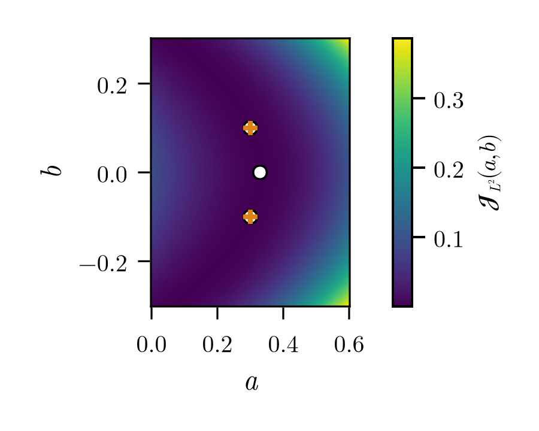
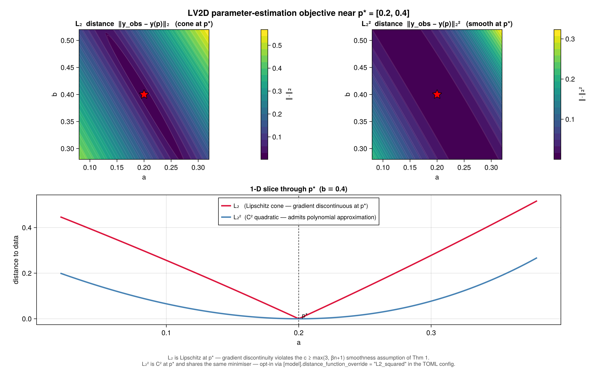

# Dynamic\_objectives

Dynamical system objective functions for global optimization and parameter estimation experiments.

These are **evaluation-only** objectives: one ODE solve per point, no gradient and no
closed form. The landscape they produce is the point — least-squares misfit against a
reference trajectory, with several true minimizers and long sloppy valleys between them.



*A locally identifiable model has several true minimizers related by a discrete symmetry.*
*Legend: contours of the least-squares misfit over the parameter box.*



*The unsquared L₂ distance is not differentiable at the minimizer; its square is C² there and shares the same minimizer.*
*Legend: left ‖y_obs − y(p)‖₂, right ‖y_obs − y(p)‖₂², bottom a 1-D slice through p\*.*
*Generated by `examples/figures/l2_vs_l2squared.jl`.*

Opt in per model with `[model].distance_function_override = "L2_squared"`: a polynomial
cannot approximate a cone, and critical-point counts measured under the unsquared
distance count the cone rather than the model.

## Overview

This package provides **29 ODE benchmark models** for testing parameter estimation algorithms. Each model creates objective functions that measure the error between simulated and reference ODE trajectories.

## Installation

Requires **Julia 1.12** or newer.

DynamicObjectives is **not yet registered in Julia General**, so it installs by URL.
Press `]` at the Julia prompt to enter Pkg mode (backspace exits):

```julia-repl
pkg> add https://github.com/gescholt/DynamicObjectives.jl
```

That is enough for **Pipeline 1** (screening / candidate discovery). **Pipeline 2** (CP
recovery) lives in a package extension and additionally needs Globtim, which is
registered:

```julia-repl
pkg> add Globtim GlobtimPostProcessing
```

Or, for development against a local checkout:

```julia-repl
pkg> develop /path/to/DynamicObjectives
```

### Optional packages

Some features are package extensions: they load when you load the package behind
them, and otherwise raise an error that names that package.

| Feature | Load |
|---|---|
| Terminal tables: `display_parameters`, `display_results`, `display_error_metrics`, `display_gradient_analysis`, `display_quality_summary`, `display_degree_comparison`, `display_top_critical_points`, the table of `display_time_series` | `using PrettyTables` |
| Panels, headers and progress: `display_section`, `display_subsection`, `display_step`, `display_model_summary`, `display_optimization_result`, `display_optimization_progress`, `progress_bar` / `with_progress`, `spinner` / `with_spinner` | `using Term` |
| Line plots: `display_comparison`, the plots of `display_time_series` (`show_plot = false` skips them) | `using UnicodePlots` |
| Stiff SDIRK solvers `"TRBDF2"` and `"KenCarp4"` (solver names in TOML configs); the solver types come from that package, not from DynamicObjectives | `using OrdinaryDiffEqSDIRK` |

The screening and objective pipelines need none of these. `"AutoTsit5"`,
`"Rodas5"` and `"Rosenbrock23"` (stiff-capable) stay in the core package.

## Quick Start

```julia
using DynamicObjectives

# Define model
model, params, states, outputs = define_lotka_volterra_2D_model_v3_two_outputs()

# Create objective function
p_true = [1.0, 0.5]
ic = [1.0, 0.5]

error_func = make_error_distance(
    model, outputs, ic, p_true,
    [0.0, 20.0], 30,
    L2_norm, first, nothing;
    return_inf_on_error = true
)

# Test
@assert error_func(p_true) < 1e-6
```

## TOML-Driven Pipelines

This package provides two TOML-driven pipelines for ODE parameter estimation:

```
Pipeline 1: Candidate Discovery (screening)
  screening TOML  -->  run_screening_from_config()  -->  catalogue JSONL

Pipeline 2: CP Recovery (Globtim experiment)
  experiment TOML  -->  run_experiment_from_config()  -->  results
```

### Pipeline 1: Candidate Discovery

For a given ODE model, screening sweeps the parameter space to find viable
`p_true` values where the trajectory is bounded and the objective landscape
is well-behaved. Top candidates are saved to a catalogue JSONL file.

Screening configs live in [`examples/exp_candidates/`](examples/exp_candidates/).

```julia
using DynamicObjectives
result = run_screening_from_config("examples/exp_candidates/lv4d.toml")
```

`lv4d.toml` screens the constrained Lotka-Volterra 4D model and writes its catalogue
next to the config. Relative paths in a config resolve against the config's directory.

### Pipeline 2: CP Recovery

Once screening has produced a catalogue, the experiment pipeline runs Globtim
polynomial CP recovery on a selected catalogue entry.

Experiment configs live in [`examples/configs/`](examples/configs/).

```julia
using DynamicObjectives, Globtim, GlobtimPostProcessing
result = run_experiment_from_config("examples/configs/lv4d_basic.toml")
```

`lv4d_basic.toml` runs LV4D at radius 0.005 on the `LV4D_1` entry of the catalogue
shipped in [`paper/catalogue/`](paper/catalogue/). The experiment configs of the paper
are in [`paper/configs/`](paper/configs/).

## Running Tests

```bash
# All tests
./run_tests.sh

# Specific test suite
./run_tests.sh basic      # Basic tests
./run_tests.sh validate   # Validate all models
```

## Documentation

- **[API Reference](https://gescholt.github.io/DynamicObjectives.jl/api.html)** — docstrings for every exported model, objective builder, and helper

The narrative documentation lives in the [Globtim docs](https://gescholt.github.io/Globtim.jl/dev/ode_parameter_estimation/), next to the optimizer that consumes these objectives:

- **[Model Catalog](https://gescholt.github.io/Globtim.jl/dev/model_catalog/)** — all 29 models with configurations and recommended testing sequences
- **[Glued Objectives](https://gescholt.github.io/Globtim.jl/dev/glued_objectives/)** — higher-dimensional problems with known critical-point sets

## License

MIT License
